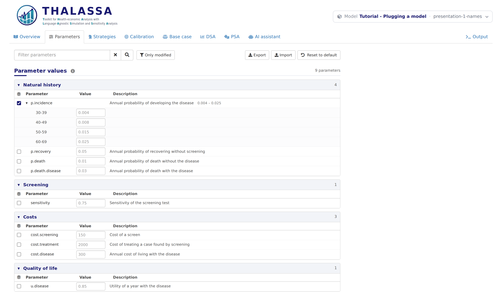

# Presentation 1: Names and units

*Stage 7 of 12 of the model integration tutorial, in its block on the
presentation of the model. Each stage is a version of this model: pick
another one in the model bar to move to it. The **Code sample** section
of this tab shows `thalassa_interface.R` as far as the tutorial has
explained it.*

The model computes everything it is going to, but the app still shows it
by the names its code uses: `p.incidence`, `screening_5y`. In this stage
the interface describes the parameters and the strategies, so that
anyone using the app can tell what they are.

Only `thalassa_interface.R` changes. `model.R` is the same as in Logic
6, and so are the results.

## Describing the parameters

Each entry of `get.parameters()` gains two more fields:

``` r
# The parameters of the model. Besides its name and value, each says what it is
# (display.name), which section it belongs to (class), the range it can take
# (min.value, max.value) and what the PSA draws it from (distribution).
get.parameters <- function() {
  list(
    # Natural history of the disease. The incidence grows with age, so it is
    # stratified: its base.value is a list with a value per age group.
    list(name = 'p.incidence', display.name = 'Annual probability of developing the disease',
         base.value = list(`30-39` = 0.004, `40-49` = 0.008, `50-59` = 0.015, `60-69` = 0.025),
         class = 'Natural history', min.value = 0, max.value = 1, distribution = 'beta'),
    list(name = 'p.recovery', display.name = 'Annual probability of recovering without screening',
         base.value = 0.05, class = 'Natural history', min.value = 0, max.value = 1,
         distribution = 'beta'),
    # The constraint is declared on both parameters it involves, so the app
    # points at both, whichever of them the user changes.
    list(name = 'p.death', display.name = 'Annual probability of death without the disease',
         base.value = 0.01, class = 'Natural history', min.value = 0, max.value = 1,
         distribution = 'beta', constraints = death.more.likely.with.disease),
    list(name = 'p.death.disease', display.name = 'Annual probability of death with the disease',
         base.value = 0.03, class = 'Natural history', min.value = 0, max.value = 1,
         distribution = 'beta', constraints = death.more.likely.with.disease),

    # Screening. The DSA varies the sensitivity over the range the literature
    # gives for it, rather than by the percentage set in the DSA tab.
    list(name = 'sensitivity', display.name = 'Sensitivity of the screening test',
         base.value = 0.75, class = 'Screening', min.value = 0, max.value = 1,
         distribution = 'beta', dsa.range = c(0.6, 0.9)),

    # Costs
    list(name = 'cost.screening', display.name = 'Cost of a screen',
         base.value = 150, class = 'Costs', min.value = 0, distribution = 'gamma'),
    list(name = 'cost.treatment', display.name = 'Cost of treating a case found by screening',
         base.value = 2000, class = 'Costs', min.value = 0, distribution = 'gamma'),
    list(name = 'cost.disease', display.name = 'Annual cost of living with the disease',
         base.value = 300, class = 'Costs', min.value = 0, distribution = 'gamma'),

    # Quality of life
    list(name = 'u.disease', display.name = 'Utility of a year with the disease',
         base.value = 0.85, class = 'Quality of life', min.value = 0, max.value = 1,
         distribution = 'beta'),

    # The discount rate is a convention rather than an uncertain value: hidden,
    # the user never sees or changes it.
    list(name = 'discount.rate', base.value = 0.03, hidden = TRUE)
  )
}
```

| Field | What it does |
|----|----|
| `display.name` | A description shown next to the name, in the Parameters tab and in the DSA and PSA trees. |
| `class` | The section the parameter is listed under. Parameters with the same class are grouped together. |

The Parameters tab now groups the parameters by class and describes each
one:

<figure style="margin: 15px 0;">

<figcaption style="font-style: italic;">The Parameters tab with the parameters described</figcaption>
</figure>

## Describing the strategies

`get.strategies()` can return one entry per strategy instead of a vector
of names:

``` r
# The strategies, each with the name run.simulation() is asked for, the name the
# app shows and a description.
get.strategies <- function() {
  list(
    list(name = 'no_screening', display.name = 'No screening',
         description = 'The disease is only found when it causes symptoms.'),
    list(name = 'screening_5y', display.name = 'Screening every 5 years',
         description = 'Everyone is screened at ages 34, 39, 44 and so on.'),
    list(name = 'screening_2y', display.name = 'Screening every 2 years',
         description = 'Everyone is screened at ages 31, 33, 35 and so on.'),
    list(name = 'screening_1y', display.name = 'Yearly screening',
         description = 'Everyone is screened every year.')
  )
}
```

- `name` is still what `run.simulation()` receives, so the model does
  not change.
- `display.name` is what the app shows.
- `description` is shown in the Strategies tab, and as a tooltip in the
  Base case tab.

## Units

`get.model.settings()` also names the units of cost and effectiveness,
which label the columns and axes of the results:

``` r
# The units the results are labelled with, and whether the AI assistant and the
# agentic calibration may read the code of the model.
get.model.settings <- function() {
  list(
    cost.unit = '€',
    effectiveness.unit = 'QALY',
    allow.code.reading = TRUE
  )
}
```

These two are the defaults, so this model could leave them out. A model
that counts life years, or costs in dollars, would set them here.

**Next:** pick the version **presentation-2-markers** in the model bar,
for *Presentation 2: Strategy markers*.
