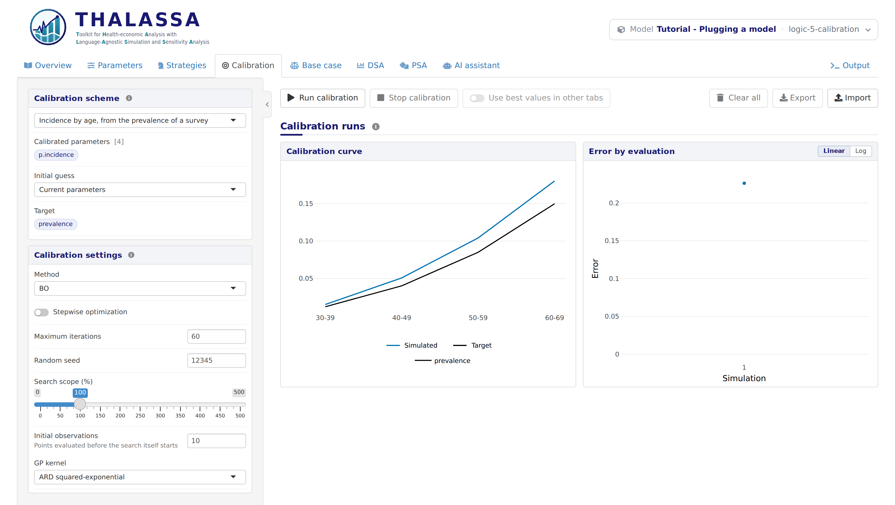
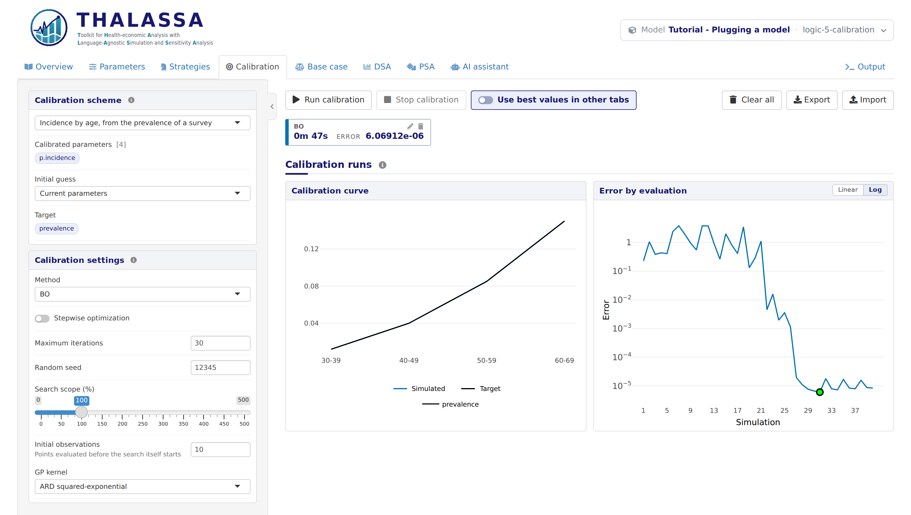

# Logic 5: Calibration

*Stage 5 of 12 of the model integration tutorial, in its block on the
logic of the model. Each stage is a version of this model: pick another
one in the model bar to move to it. The **Code sample** section of this
tab shows `thalassa_interface.R` as far as the tutorial has explained
it.*

The incidence of each age group in Logic 3 was a
guess. What is known is the *prevalence*: a survey of a population that
is not screened found the share of people with the disease in each age
group. Calibration searches for the incidence values that make the model
reproduce that prevalence.

In this stage the model offers that calibration to the Calibration tab.
It does so with `get.calibration.schemes()`, which describes what to
calibrate, against what, and how to measure how far the model is from
it.

## The output to compare

`model.R` gains a function that computes the prevalence of each age
group from the yearly trace of a simulation:

``` r
# The share of the people alive who have the disease, averaged over the years
# of each age group, from the trace of a simulation. This is what the
# calibration compares with the prevalence observed in a survey.
prevalence.by.age <- function(trace) {
  prevalence <- trace$disease / (trace$healthy + trace$disease)
  groups <- age.group(trace$age)
  sapply(AGE.GROUPS, function(group) mean(prevalence[groups == group]))
}
```

## Measuring the error

A calibration needs a single number to minimize: how far a set of
parameter values puts the model from the target. The interface computes
it in two steps.

The first step scores an output against the target. Here it is the sum
of the squared relative differences between the simulated and the
observed prevalence:

``` r
# The error of a simulated output: how far the prevalence of each age group is
# from the one observed, as a sum of squared relative differences. It needs the
# output and the target alone, without running the model.
prevalence.error <- function(output, target) {
  observed <- unlist(target$prevalence)
  simulated <- output$prevalence[names(observed)]
  sum(((simulated - observed) / observed)^2)
}
```

The second step runs the model with a set of parameter values and scores
its output with the first:

``` r
# The error of a parameter set: simulates it and scores the output. The survey
# was taken in a population that is not screened, so the reference strategy is
# what is simulated.
prevalence.calibration.error <- function(parameters, target) {
  trace <- simulate('no_screening', parameters)$trace
  output <- list(prevalence = prevalence.by.age(trace))
  list(error = prevalence.error(output, target), output = output)
}
```

It returns a list of two things:

- `error`, the number the calibration minimizes;
- `output`, the simulated values behind it, which the Calibration tab
  plots against the target. Name the values of each output by stratum,
  as the target is.

Why two functions rather than one? Some calibration methods predict the
output of the model rather than simulate it, and need to score those
predictions without running the model. Giving them the first function,
as `output_error`, lets them do so. It is optional, but cheap to provide
when the error is written this way.

## The scheme

`get.calibration.schemes()` returns a named list of schemes. This model
has one:

``` r
# The calibrations the Calibration tab offers. This one finds the incidence of
# each age group that reproduces the prevalence a survey observed.
get.calibration.schemes <- function() {
  list(
    prevalence = list(
      description = 'Incidence by age, from the prevalence of a survey',
      parameters = c('p.incidence'),
      strata = AGE.GROUPS,
      target = list(
        prevalence = list(`30-39` = 0.012, `40-49` = 0.040, `50-59` = 0.085, `60-69` = 0.150)
      ),
      error_function = prevalence.calibration.error,
      output_error = prevalence.error
    )
  )
}
```

| Field | What it is |
|----|----|
| `description` | The name of the scheme in the Calibration tab. |
| `parameters` | The parameters to calibrate, by name. |
| `strata` | The strata to calibrate them in. A stratum left out keeps its value. |
| `target` | The observed values, one list per output, each value named by its stratum. |
| `error_function` | The error of a set of parameter values: `function(parameters, target)`. |
| `output_error` | Optional. The error of an output: `function(output, target)`. |

The calibration searches over the incidence of the four age groups: four
values, kept within the search scope set in the tab. By default, that is
from 0 to twice the value each starts from.

`try_model.R` now also prints the error of the scheme at the base
values, and the output it was computed from:

          strategy         C        E
    1 no_screening  362.8502 20.04445
    2 screening_5y  954.3307 20.29808
    3 screening_2y 1884.2896 20.39993
    4 screening_1y 3447.2018 20.44715

    Scheme prevalence - error at the base values: 0.2260882 
    List of 1
     $ prevalence: Named num [1:4] 0.015 0.0506 0.1042 0.1805
      ..- attr(*, "names")= chr [1:4] "30-39" "40-49" "50-59" "60-69"

## Letting a language model read the code

THALASSA can use a language model in two places: the AI assistant tab,
and the agentic calibration method, which proposes values with a
language model. Both may read the source code of the model to understand
it. `get.model.settings()`, an optional function, says whether they may:

``` r
# Whether the AI assistant and the agentic calibration may read the code of the
# model.
get.model.settings <- function() {
  list(
    allow.code.reading = TRUE
  )
}
```

`TRUE` is the default. Set it to `FALSE` for a model whose code should
not be sent to a language model.

## What works now

Open the **Calibration** tab. It simulates the starting values and plots
the prevalence they give against the target:

<figure style="margin: 15px 0;">

<figcaption style="font-style: italic;">The calibration scheme, before calibrating</figcaption>
</figure>

Pick a method, for example BO (Bayesian optimization), and click **Run
calibration**. Each evaluation is one call of the error function. The
error plot on the right shows the error of each evaluation, and the best
one is marked in green:

<figure style="margin: 15px 0;">

<figcaption style="font-style: italic;">After a calibration</figcaption>
</figure>

The simulated prevalence now lies on the target. Turn on **Use best
values in other tabs** to run the Base case, DSA and PSA with the
calibrated incidence.

Simulating the starting values as soon as the tab opens is fine for a
quick model. For a model that takes minutes to run, add
`run.initial.guess = FALSE` to `get.model.settings()`, and the tab waits
until a calibration is started.

**Next:** pick the version **logic-6-calibration-constraints** in the
model bar, for *Logic 6: Constraints on a calibration*.
