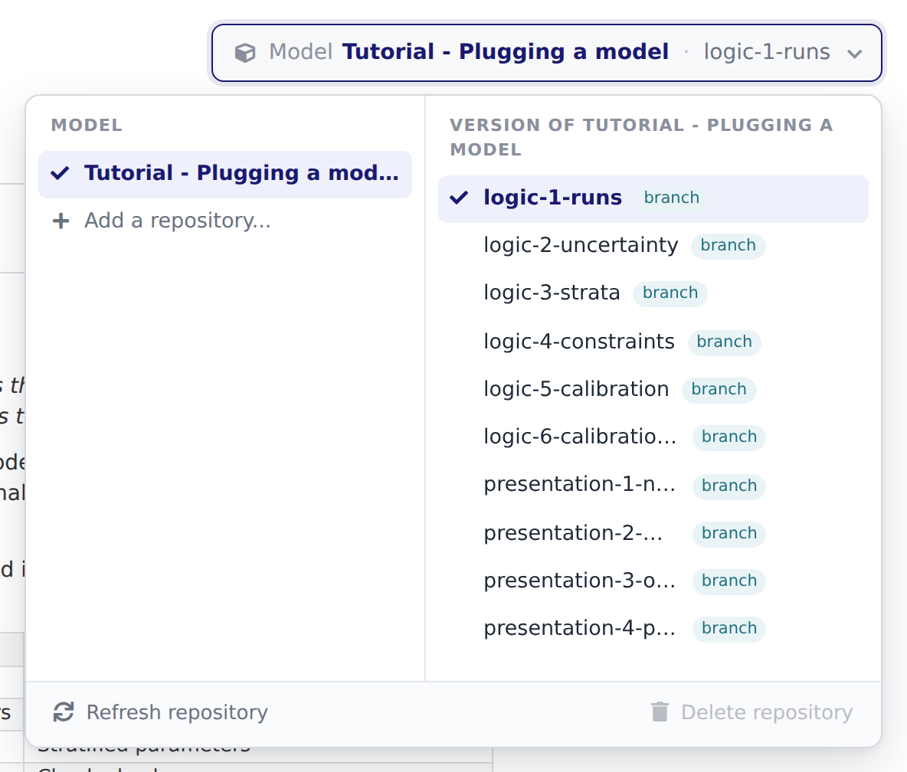
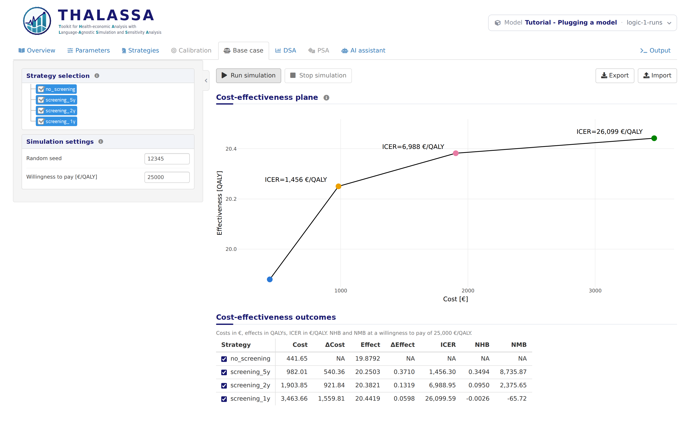

# Logic 1: A model that runs

*You are reading the model integration tutorial of THALASSA, in the app
itself. Each stage is a version of this model, and its page is the
Overview tab of that version: pick another version in the model bar, at
the top right of the app, to move to another stage. The **Code sample**
section of this tab shows `thalassa_interface.R` as far as the tutorial
has explained it.*

This tutorial connects a simulation model to THALASSA one step at a
time. It starts from the least code the app needs to run a model, and
each stage adds one feature and explains it. It is written for someone
who knows R and their own model, and has not connected a model to
THALASSA before. Each stage results in a functional model on THALASSA,
with an increasing amount of functionality and detail.

The stages form two blocks. The first is the **logic** of the model:
what it computes and what the analyses can do with it. The second is its
**presentation**: how it reads to the people who use it, which changes
no result. The last stages, on **setup**, explain what a model needs
around its code.

| Stage | Version | What it adds | What the app gains |
|----|----|----|----|
| Logic 1. A model that runs | `logic-1-runs` | The three required functions | Base case and DSA |
| Logic 2. Ranges and distributions | `logic-2-uncertainty` | Ranges, distributions, DSA ranges, hidden parameters | PSA, range checks |
| Logic 3. Age groups | `logic-3-strata` | Strata, and a parameter with a value per age group | Stratified parameters |
| Logic 4. Constraints on the parameters | `logic-4-constraints` | Rules the values of the parameters must follow | Checked values |
| Logic 5. Calibration | `logic-5-calibration` | A calibration scheme and its error function | Calibration |
| Logic 6. Constraints on a calibration | `logic-6-calibration-constraints` | The region a calibration searches in | Constrained calibration |
| Presentation 1. Names and units | `presentation-1-names` | Display names, sections, descriptions, units | Readable tabs |
| Presentation 2. Strategy markers | `presentation-2-markers` | The attributes of the strategies | Chosen markers on the plot |
| Presentation 3. Explaining the model | `presentation-3-overview` | Overview text, state diagram, code sample | A documented model |
| Presentation 4. Evaluation plots | `presentation-4-plots` | A plot of each calibration evaluation | Plots of your own |
| Setup 1. The dependencies of a model | `setup-1-dependencies` | How packages get installed, and pinned versions | Results that don’t change with new releases |
| Setup 2. A conda environment of your own | `setup-2-environment` | An `environment.yml` | Other languages and system libraries |

In this stage you connect a model to THALASSA with as little code as
possible: three functions in one file. By the end, the app runs the base
case and the deterministic sensitivity analysis (DSA) of the model.

**Does your model need more than R and its usual packages?** If part of
it is in another language, or it needs specific versions of R or of its
packages, it may not load until its setup is right. Setup
1 and Setup 2, at
the end of this tutorial, explain how to do that, and you can read them
at any time.

## The model

The model of this tutorial follows a group of people, a *cohort*, from
age 30 to age 70, one year at a time. Each year some of them develop a
disease, some recover from it, and some die. The strategies compare not
screening for the disease with screening every 5, 2 or 1 years. A screen
finds part of the people who have the disease, who are then treated and
cured.

The model is in `model.R`, under 100 lines
of base R, so the tutorial can focus on the interface rather than on the
model. You don’t need to read it to follow the tutorial. What matters is
the one function THALASSA will call, `simulate(strategy, pars)`. It
simulates one strategy with a list of parameter values and returns the
cost and the quality-adjusted life years (QALYs) of the cohort:

``` r
# Simulates one strategy with the parameter values in `pars`, a named list.
# Returns the discounted cost and QALYs of the cohort, and its trace: the share
# of the cohort in each state at the start of every year.
simulate <- function(strategy, pars) {
  ...
}
```

`model.R` knows nothing about THALASSA. That is how it should be: your
model stays your own code, and a separate file connects it to the app.

## The repository

THALASSA loads a model from a git repository. The repository needs one
file at its root, `thalassa_interface.R`, which defines the functions
the app calls. This stage has four files:

| File | What it is |
|----|----|
| `model.R` | The model itself |
| `thalassa_interface.R` | What THALASSA reads the model through |
| `try_model.R` | A script to run the model from R, without the app |
| `tutorial.md` | The page of this stage, which the Overview tab shows |

THALASSA runs `thalassa_interface.R` with the root of the repository as
the working directory. So the interface reads the other files of the
repository by their relative path:

``` r
source('model.R')
```

A model that loads R packages needs nothing more for that: the app finds
the packages these files load, and installs them. Setup
1 explains how, and what else you can do.

## The three required functions

### `get.strategies()`

It returns the names of the strategies:

``` r
# The names of the strategies, which is what run.simulation() is asked for.
get.strategies <- function() {
  c('no_screening', 'screening_5y', 'screening_2y', 'screening_1y')
}
```

These names are what the app asks `run.simulation()` to simulate.

### `get.parameters()`

It returns the parameters, as a list with one entry per parameter. Each
entry needs a `name` and a `base.value`, the value the parameter takes
unless the user changes it:

``` r
# The parameters of the model and the value each takes by default.
get.parameters <- function() {
  list(
    list(name = 'p.incidence', base.value = 0.01),
    list(name = 'p.recovery', base.value = 0.05),
    list(name = 'p.death', base.value = 0.01),
    list(name = 'p.death.disease', base.value = 0.03),
    list(name = 'sensitivity', base.value = 0.75),
    list(name = 'cost.screening', base.value = 150),
    list(name = 'cost.treatment', base.value = 2000),
    list(name = 'cost.disease', base.value = 300),
    list(name = 'u.disease', base.value = 0.85),
    list(name = 'discount.rate', base.value = 0.03)
  )
}
```

### `run.simulation()`

It simulates the strategies it is asked for with the parameter values it
is given, and returns the results:

``` r
# Simulates each strategy with the parameter values the app gives, a named list,
# and returns their cost (C) and effectiveness (E) in a data frame named summary.
run.simulation <- function(strategies, parameters) {
  results <- lapply(strategies, simulate, pars = parameters)
  summary <- data.frame(
    strategy = strategies,
    C = sapply(results, function(r) r$cost),
    E = sapply(results, function(r) r$effectiveness)
  )
  list(summary = summary)
}
```

- `strategies` is a vector of strategy names, from those of
  `get.strategies()`.
- `parameters` is a named list with a value for every parameter of
  `get.parameters()`: `parameters$p.incidence`,
  `parameters$cost.screening`, and so on. These are the values the user
  has set in the Parameters tab.
- The result is a list with a data frame named `summary`. It has one row
  per strategy and three columns: `strategy`, its cost `C` and its
  effectiveness `E`.

That is the whole interface a model needs. The **Code sample** section
at the top of this tab shows it together. The file in the repository has
a little more, which puts this page and that code in the Overview tab,
and which Presentation 3 explains.

## Try it from R

Before loading a model in the app, check that it runs. `try_model.R`
builds the parameter list the way THALASSA does, with every parameter at
its base value, and calls `run.simulation()` with every strategy. Run it
from the directory of the model:

``` bash
Rscript try_model.R
```

          strategy         C        E
    1 no_screening  441.6538 19.87920
    2 screening_5y  982.0133 20.25025
    3 screening_2y 1903.8521 20.38215
    4 screening_1y 3463.6591 20.44191

If this fails, the app will fail the same way, and the error is easier
to read here.

## Load it in THALASSA

This has already happened, or you would not be reading this: the page is
the Overview tab of the version **logic-1-runs** of the tutorial model,
whose repository is
<a href="https://github.com/david-gomez-guillen/cea-model-tutorial" target="_blank">cea-model-tutorial</a>.
To load another model, or another version of this one, open the model
bar at the top right of the app, pick the model, and pick the version:

<figure style="margin: 15px 0;">

<figcaption style="font-style: italic;">The model bar, with the tutorial model and its versions</figcaption>
</figure>

Every branch of the repository is a version of the model. The tutorial
uses this to keep one branch per stage, and you can do the same to keep
several versions of your own model side by side.

If the model fails to load, the Output tab, at the right end of the tab
row, shows the error.

## What works now

Open the **Base case** tab, tick the strategies in the tree, and click
**Run simulation**:

<figure style="margin: 15px 0;">

<figcaption style="font-style: italic;">The base case of the first stage</figcaption>
</figure>

The plot shows the cost and effectiveness of each strategy, and the
incremental cost-effectiveness ratio (ICER) of each strategy against the
previous one on the efficiency frontier. Every additional screen buys a
little more health at a higher price per QALY.

The **DSA** tab works too: it varies each parameter around its base
value and shows how much the result moves. The rest is still missing:

- The **PSA** tab has no parameter to sample, because no parameter says
  which distribution it is drawn from. Logic 2
  adds that.
- The **Calibration** tab is disabled until Logic
  5.
- The tabs show parameters and strategies by their bare names, such as
  `p.incidence` and `screening_5y`. They stay that way while the
  tutorial works on the logic of the model, and Presentation
  1 describes them.
- The **Overview** tab shows the page of this stage. A model that gives
  no text of its own gets a summary the app builds from the interface,
  and Presentation 3 explains how to give
  one.

**Next:** pick the version **logic-2-uncertainty** in the model bar, for
*Logic 2: Ranges and distributions*.
