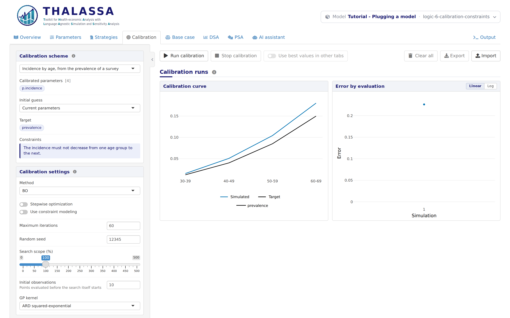

# Logic 6: Constraints on a calibration

*Stage 6 of 12 of the model integration tutorial, in its block on the
logic of the model. Each stage is a version of this model: pick another
one in the model bar to move to it. The **Code sample** section of this
tab shows `thalassa_interface.R` as far as the tutorial has explained
it.*

The incidence of the disease should not fall with age, and nothing has
told the calibration so. In this stage the scheme of Logic
5 says it, which keeps the search inside the
region where the values make sense.

This is separate from the constraints of Logic
4, and a model can have either one without the
other: those check the values someone is about to run, and these guide a
search.

## The constraints of a scheme

A calibration does not read the parameter constraints. It searches over
a vector of numbers, the *calibration vector*: here, the incidence of
the four age groups, in the order of `AGE.GROUPS`. A scheme constrains
that vector with a `constraints` function of its own:

``` r
      # The search is kept where the incidence does not fall with age. x holds
      # the incidence of each age group, in the order of AGE.GROUPS, and each
      # value returned is a constraint, met when it is 0 or less: here, minus
      # the increase from one age group to the next.
      constraints = function(x, partial = FALSE) {
        # A stepwise calibration goes one age group at a time and asks about
        # the ones it has so far. The first step has nothing to compare yet:
        # the -1, always met, still gives it a constraint.
        if (partial) return(c(-1, -diff(x)))
        -diff(x)
      },
      # The same, in words: shown in the tab and given to the agentic method.
      constraints_description = function() {
        'The incidence must not decrease from one age group to the next.'
      }
```

It returns one number per constraint, and a constraint is met when its
number is 0 or less. Returning numbers rather than `TRUE` or `FALSE`
lets some methods learn how close the search is to the edge of the
region.

`-diff(x)` holds the decrease from each age group to the next, which
must be 0 or less. At the base values every constraint is met, and an
incidence that falls from the first age group to the second breaks the
first constraint:

``` r
scheme <- get.calibration.schemes()$prevalence
scheme$constraints(c(0.004, 0.008, 0.015, 0.025))
scheme$constraints(c(0.004, 0.003, 0.015, 0.025))
```

    [1] -0.004 -0.007 -0.010
    [1]  0.001 -0.012 -0.010

The `partial` argument is only needed for a *stepwise* calibration,
which the Calibration tab offers for a model with strata: it calibrates
one age group at a time and asks about the age groups it has calibrated
so far. A scheme that leaves out the argument still works, but then a
stepwise calibration cannot check each step on its own.

`constraints_description` says the same in words. The Calibration tab
shows it, and the agentic calibration method reads it.

## What works now

Open the **Calibration** tab:

<figure style="margin: 15px 0;">

<figcaption style="font-style: italic;">A constrained calibration scheme</figcaption>
</figure>

A constrained scheme changes what the tab offers:

- the Bayesian optimization methods get a **Use constraint modeling**
  switch, which learns the constraints from the evaluations as the
  search goes;
- SCBO, a method built for constrained problems, appears in the method
  list.

On the error plot, evaluations that break a constraint are shaded in
red. You can see them in the figure of Presentation
4.

## The end of the logic

Every analysis of the app now works on this model, and the logic of the
model is complete. From here on `model.R` does not change, and neither
do the results: `try_model.R` prints the same in every stage that
follows. They change how the model reads to the people who use it. A
model only you will run can stop here.

**Next:** pick the version **presentation-1-names** in the model bar,
for *Presentation 1: Names and units*.
