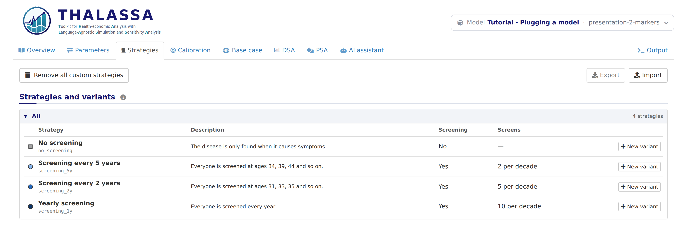
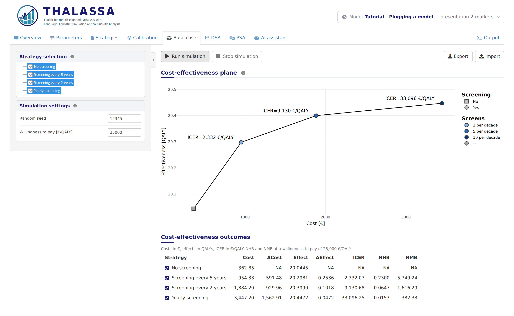

# Presentation 2: Strategy markers

*Stage 8 of 12 of the model integration tutorial, in its block on the
presentation of the model. Each stage is a version of this model: pick
another one in the model bar to move to it. The **Code sample** section
of this tab shows `thalassa_interface.R` as far as the tutorial has
explained it.*

On the base case plot, every strategy is a point. By default the app
picks their shapes and colours itself. A model can choose them instead,
from what describes each strategy: its *attributes*.

## The attributes of the strategies

Each strategy gives the values of its attributes:

``` r
# The strategies, each with the name run.simulation() is asked for, the name the
# app shows, a description and its attributes, declared below.
get.strategies <- function() {
  list(
    list(name = 'no_screening', display.name = 'No screening',
         description = 'The disease is only found when it causes symptoms.',
         attributes = list(screening = 'No')),
    list(name = 'screening_5y', display.name = 'Screening every 5 years',
         description = 'Everyone is screened at ages 34, 39, 44 and so on.',
         attributes = list(screening = 'Yes', frequency = '2 per decade')),
    list(name = 'screening_2y', display.name = 'Screening every 2 years',
         description = 'Everyone is screened at ages 31, 33, 35 and so on.',
         attributes = list(screening = 'Yes', frequency = '5 per decade')),
    list(name = 'screening_1y', display.name = 'Yearly screening',
         description = 'Everyone is screened every year.',
         attributes = list(screening = 'Yes', frequency = '10 per decade'))
  )
}
```

and `get.strategy.attributes()` declares them, and says which ones the
plot draws:

``` r
# What describes the strategies: a column of the Strategies tab each, and how
# the base case plot draws them. Whether a strategy screens is the shape of its
# point, and how often it does its fill, darker the more often.
get.strategy.attributes <- function() {
  list(
    screening = list(label = 'Screening', plot = 'shape',
                     values = c(No = 'square', Yes = 'circle')),
    frequency = list(label = 'Screens', plot = 'fill', ordered = TRUE)
  )
}
```

- `label` names the attribute in the Strategies tab and in the legend.
- `plot` is what draws it: `"shape"`, `"fill"`, `"border"`, `"colour"`
  or `"size"`. An attribute without `plot` is only a column of the
  Strategies tab.
- `values` picks the shape, or colour, of each value. Without it the app
  chooses.
- `ordered = TRUE` draws a colour from light to dark, in the order of
  the numbers the values start with.

## What works now

The Strategies tab lists the attributes, with the marker of each
strategy:

<figure style="margin: 15px 0;">

<figcaption style="font-style: italic;">The Strategies tab with the attributes</figcaption>
</figure>

and the base case plot draws them, with a legend for each attribute:

<figure style="margin: 15px 0;">

<figcaption style="font-style: italic;">The base case plot with the markers of the attributes</figcaption>
</figure>

Not screening has no frequency of screens, so its fill takes the neutral
grey of the “—” entry of the legend.

**Next:** pick the version **presentation-3-overview** in the model bar,
for *Presentation 3: Explaining the model*.
