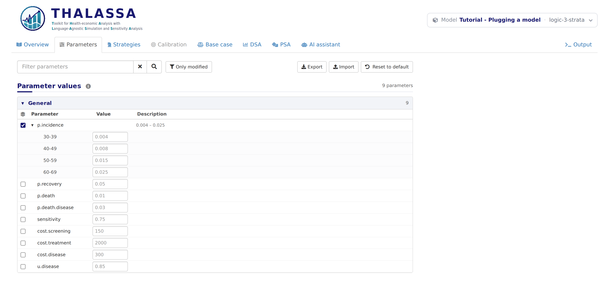

# Logic 3: Age groups

*Stage 3 of 12 of the model integration tutorial, in its block on the
logic of the model. Each stage is a version of this model: pick another
one in the model bar to move to it. The **Code sample** section of this
tab shows `thalassa_interface.R` as far as the tutorial has explained
it.*

A disease is rarely as likely at 65 as at 35. In this stage the
incidence of the disease takes a different value in each age group.
THALASSA calls these groups *strata*: a model declares its strata once,
and any parameter can take one value per stratum.

Strata are optional. A model whose parameters are the same for everyone
can skip this stage. But the calibration of Logic
5 calibrates the incidence of each age group,
so this model needs them.

## Declaring the strata

`get.strata()` returns the names of the strata. Here they are the age
groups, which `model.R` defines:

``` r
# The strata of the model: the age groups of model.R.
get.strata <- function() {
  AGE.GROUPS
}
```

``` r
# The age groups, which are the strata of the model: a parameter can take a
# different value in each.
AGE.GROUPS <- c('30-39', '40-49', '50-59', '60-69')
```

## A stratified parameter

A stratified parameter gives its `base.value` as a list, with one value
per stratum, named by the stratum:

``` r
    # Natural history of the disease. The incidence grows with age, so it is
    # stratified: its base.value is a list with a value per age group.
    list(name = 'p.incidence',
         base.value = list(`30-39` = 0.004, `40-49` = 0.008, `50-59` = 0.015, `60-69` = 0.025),
         min.value = 0, max.value = 1, distribution = 'beta'),
```

The other fields, such as `min.value` and `distribution`, are written
once and hold for every stratum. A parameter can also be declared as one
entry per stratum, each naming its `stratum` and giving its own
`base.value`, which is how a field that differs between strata, such as
`min.value`, is given:

``` r
list(name = 'p.incidence', stratum = '30-39', base.value = 0.004, ...),
list(name = 'p.incidence', stratum = '40-49', base.value = 0.008, ...),
```

## What the model receives

`run.simulation()` now receives a stratified parameter as a list with
one value per stratum, named by the stratum. The other parameters are
still single numbers:

    List of 2
     $ p.incidence:List of 4
      ..$ 30-39: num 0.004
      ..$ 40-49: num 0.008
      ..$ 50-59: num 0.015
      ..$ 60-69: num 0.025
     $ p.recovery : num 0.05

## Reading the parameters in the model

`model.R` now looks up the age group of each year, and reads the value
of every parameter in that group through a small function, `at()`:

``` r
age.group <- function(age) AGE.GROUPS[(age - START.AGE) %/% 10 + 1]

# The value of a parameter in an age group. A stratified parameter is a list
# with a value per age group, and any other is a single number, so every
# parameter is read through at(): the Parameters tab lets the user split any of
# them into age groups.
at <- function(value, group) if (is.list(value)) value[[group]] else value
```

``` r
    # The transitions of the year.
    onset <- healthy * at(pars$p.incidence, group)
    death.healthy <- healthy * at(pars$p.death, group)
    recovery <- disease * at(pars$p.recovery, group)
    death.disease <- disease * at(pars$p.death.disease, group)
```

Why read every parameter through `at()`, and not just the incidence?
Because in a model with strata, the Parameters tab lets the user split
*any* parameter into strata, with the checkbox at the start of its row.
A parameter the user has split arrives as a list, like the incidence
does. Reading every parameter the same way means the model handles both
cases.

The results change, since the incidence now rises with age:

          strategy         C        E
    1 no_screening  362.8502 20.04445
    2 screening_5y  954.3307 20.29808
    3 screening_2y 1884.2896 20.39993
    4 screening_1y 3447.2018 20.44715

## What works now

The incidence has a value per age group in the Parameters tab, and its
checkbox is ticked:

<figure style="margin: 15px 0;">

<figcaption style="font-style: italic;">A stratified parameter in the Parameters tab</figcaption>
</figure>

Every other parameter can be split the same way, by ticking its
checkbox.

**Next:** pick the version **logic-4-constraints** in the model bar, for
*Logic 4: Constraints on the parameters*.
