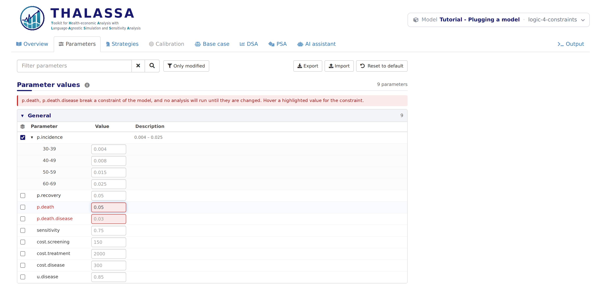

# Logic 4: Constraints on the parameters

*Stage 4 of 12 of the model integration tutorial, in its block on the
logic of the model. Each stage is a version of this model: pick another
one in the model bar to move to it. The **Code sample** section of this
tab shows `thalassa_interface.R` as far as the tutorial has explained
it.*

Not every combination of values makes sense. People with the disease
should not be *less* likely to die than people without it, whatever each
value is on its own. In this stage the model says so, which stops the
user, or a sensitivity analysis, from running it with values it does not
accept.

Only `thalassa_interface.R` changes, and the results do not.

## A constraint

A parameter constraint is a function of two arguments: the name of the
parameter, and the whole list of parameter values, as `run.simulation()`
receives it. It returns `TRUE` when the values are acceptable, and
otherwise the message the app shows:

``` r
# A constraint on the parameters: the disease cannot make death less likely.
# It returns TRUE when the values are acceptable, and the message the app shows
# when they are not. unlist() reads a parameter the user has split into age
# groups as all its values.
death.more.likely.with.disease <- function(par.name, params) {
  if (any(unlist(params$p.death.disease) <= unlist(params$p.death)))
    'The probability of death with the disease must be above the one without it'
  else TRUE
}
```

It is attached to a parameter with the `constraints` field of its entry.
This one involves two parameters, and is attached to both:

``` r
    # The constraint is declared on both parameters it involves, so the app
    # points at both, whichever of them the user changes.
    list(name = 'p.death', base.value = 0.01, min.value = 0, max.value = 1,
         distribution = 'probability', constraints = death.more.likely.with.disease),
    list(name = 'p.death.disease', base.value = 0.03, min.value = 0, max.value = 1,
         distribution = 'probability', constraints = death.more.likely.with.disease),
```

A few things to know:

- A `constraints` field can also hold a list of functions, each checked
  on its own.
- `min.value` and `max.value`, from Logic 2,
  are checked the same way, so there is no need to write a constraint
  for a range.
- Return `TRUE` explicitly. An `if` with no `else` returns `NULL` when
  the values are fine, which the app reports as an error in the model.
- The user can split any parameter into age groups, as Logic
  3 explains, so a constraint may find a list where
  it expects a number. `unlist()` reads both.

## What works now

When a value breaks a constraint, the Parameters tab highlights the
parameters involved, and no analysis runs until it is fixed. Hovering a
highlighted value shows the message:

<figure style="margin: 15px 0;">

<figcaption style="font-style: italic;">A value breaking a constraint</figcaption>
</figure>

The DSA checks both ends of the range of every parameter before it
starts, and the PSA draws again any sample that breaks a constraint.

**Next:** pick the version **logic-5-calibration** in the model bar, for
*Logic 5: Calibration*.
