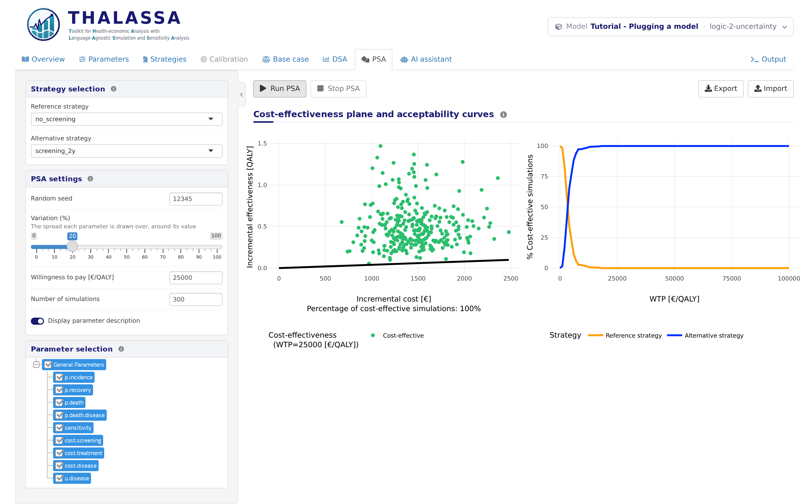

# Logic 2: Ranges and distributions

*Stage 2 of 12 of the model integration tutorial, in its block on the
logic of the model. Each stage is a version of this model: pick another
one in the model bar to move to it. The **Code sample** section of this
tab shows `thalassa_interface.R` as far as the tutorial has explained
it.*

The model of Logic 1 runs, but the app knows nothing
about its parameters beyond their values: not what values they can take,
nor how uncertain they are. In this stage each parameter says so. That
lets the app refuse values that make no sense, and it is what the
probabilistic sensitivity analysis (PSA) needs.

Only `thalassa_interface.R` changes. `model.R` is the same as in Logic
1, and so are the results.

**Does your model need more than R and its usual packages?** If part of
it is in another language, or it needs specific versions of R or of its
packages, it may not load until its setup is right. Setup
1 and Setup 2, at
the end of this tutorial, explain how to do that, and you can read them
at any time.

## What each parameter says about its values

Each entry of `get.parameters()` can carry more than its name and value:

``` r
# The parameters of the model. Besides its name and value, each says the range it
# can take (min.value, max.value) and what the PSA draws it from (distribution).
get.parameters <- function() {
  list(
    # Natural history of the disease
    list(name = 'p.incidence', base.value = 0.01, min.value = 0, max.value = 1,
         distribution = 'beta'),
    list(name = 'p.recovery', base.value = 0.05, min.value = 0, max.value = 1,
         distribution = 'beta'),
    list(name = 'p.death', base.value = 0.01, min.value = 0, max.value = 1,
         distribution = 'beta'),
    list(name = 'p.death.disease', base.value = 0.03, min.value = 0, max.value = 1,
         distribution = 'beta'),

    # Screening. The DSA varies the sensitivity over the range the literature
    # gives for it, rather than by the percentage set in the DSA tab.
    list(name = 'sensitivity', base.value = 0.75, min.value = 0, max.value = 1,
         distribution = 'beta', dsa.range = c(0.6, 0.9)),

    # Costs
    list(name = 'cost.screening', base.value = 150, min.value = 0, distribution = 'gamma'),
    list(name = 'cost.treatment', base.value = 2000, min.value = 0, distribution = 'gamma'),
    list(name = 'cost.disease', base.value = 300, min.value = 0, distribution = 'gamma'),

    # Quality of life
    list(name = 'u.disease', base.value = 0.85, min.value = 0, max.value = 1,
         distribution = 'beta'),

    # The discount rate is a convention rather than an uncertain value: hidden,
    # the user never sees or changes it.
    list(name = 'discount.rate', base.value = 0.03, hidden = TRUE)
  )
}
```

| Field | What it does |
|----|----|
| `min.value`, `max.value` | The range the parameter can take. The app refuses to run with a value outside it. |
| `distribution` | What the PSA draws the parameter from: `"beta"`, `"gamma"`, `"normal"`, `"lognormal"` or `"exponential"`. |
| `dsa.range` | The two values the DSA tries, lower first, instead of the base value ± the percentage set in the DSA tab. |
| `hidden` | `TRUE` keeps the parameter out of the app. It is always simulated at its base value. |

Some guidance on choosing them:

- **Distributions.** Use beta for probabilities and utilities, which lie
  between 0 and 1, and gamma for costs, which cannot be negative.
  Lognormal suits relative risks and hazard ratios. A parameter with no
  distribution is never sampled by the PSA.
- **DSA ranges.** Give one when the literature reports an interval for
  the parameter, as for the sensitivity of the test here.
- **Hidden parameters.** The discount rate is a convention rather than
  an uncertain value, so it is hidden, and no analysis varies it. The
  model still receives it in `run.simulation()`.

## What works now

The **PSA** tab offers every parameter with a distribution. Pick a
reference strategy and an alternative, tick the parameters, and click
**Run PSA**:

<figure style="margin: 15px 0;">

<figcaption style="font-style: italic;">The PSA with the distributions of the parameters</figcaption>
</figure>

Each point is one simulation with every ticked parameter drawn from its
distribution. On the right, the acceptability curves show how often each
strategy is cost-effective at each willingness to pay.

**Next:** pick the version **logic-3-strata** in the model bar, for
*Logic 3: Age groups*.
