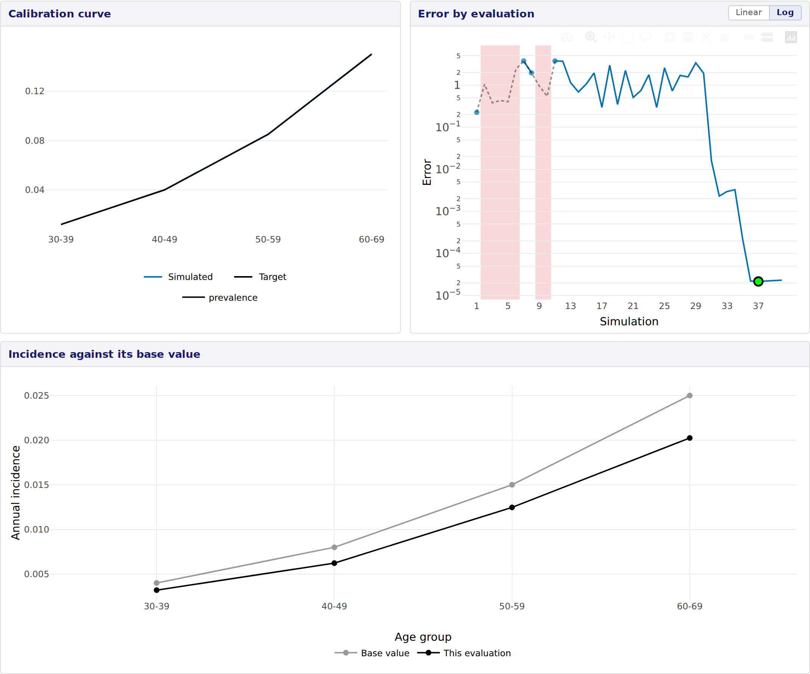

# Presentation 4: Evaluation plots

*Stage 10 of 12 of the model integration tutorial, in its block on the
presentation of the model. Each stage is a version of this model: pick
another one in the model bar to move to it. The **Code sample** section
of this tab shows the complete `thalassa_interface.R` of this stage.*

This stage draws a plot of its own in the Calibration tab. So far the
model has used base R alone, and this plot needs a package, ggplot2.

## An evaluation plot

The Calibration tab plots the outputs of each evaluation against the
target. A scheme can add plots of its own, of whatever else helps judge
an evaluation. The base values of the incidence were a guess, so this
one draws the incidence an evaluation tried in each age group next to
them:

``` r
# A plot of one evaluation of a calibration: the incidence it tried in each age
# group, next to the base value of that group. The Calibration tab draws it under
# the calibration curve, for the evaluation hovered on the error plot. `values` holds
# the calibrated parameters and the simulated outputs of that evaluation, the
# incidence of an age group named as p.incidence.<age group>.
incidence.plot <- function(values) {
  incidence <- Filter(function(p) p$name == 'p.incidence', get.parameters())[[1]]
  base <- unname(unlist(incidence$base.value)[AGE.GROUPS])
  tried <- unname(values[paste0('p.incidence.', AGE.GROUPS)])
  df <- data.frame(group = rep(AGE.GROUPS, 2),
                   series = rep(c('This evaluation', 'Base value'), each = length(AGE.GROUPS)),
                   incidence = c(tried, base))
  # The app shows the text aesthetic when a point is hovered.
  df$text <- sprintf('Age %s, %s: %.4f', df$group, tolower(df$series), df$incidence)
  ggplot(df, aes(x = group, y = incidence, colour = series, group = series, text = text)) +
    geom_line() +
    geom_point() +
    scale_colour_manual(values = c(`This evaluation` = 'black', `Base value` = 'grey60')) +
    labs(x = 'Age group', y = 'Annual incidence', colour = NULL) +
    theme_minimal()
}
```

- The function receives the values of one evaluation, as a named vector:
  the calibrated parameters, named `<parameter>.<stratum>`, and the
  simulated outputs.
- It returns a ggplot. The app turns it into an interactive plot, which
  shows the `text` aesthetic when a point is hovered.
- It has to draw the same elements for every evaluation, since hovering
  moves the values of the plot on screen rather than drawing it again.

The scheme lists its plots under `evaluation.plots`, each under the
title the tab shows it by:

``` r
      # Plots of one evaluation, each under the title it is listed by.
      evaluation.plots = list(`Incidence against its base value` = incidence.plot)
```

The plot follows the evaluation hovered, or clicked, on the error plot.
Here the best evaluation puts the incidence of every age group about a
fifth below its base value:

<figure style="margin: 15px 0;">

<figcaption style="font-style: italic;">The evaluation plot under the calibration plots</figcaption>
</figure>

## The package it needs

The interface now loads ggplot2, in the usual way:

``` r
library(ggplot2)
```

Nothing else was needed: the app sees that line and installs the
package. Setup 1 explains how, and what to do
when that is not enough.

**Next:** pick the version **setup-1-dependencies** in the model bar,
for *Setup 1: The dependencies of a model*.
